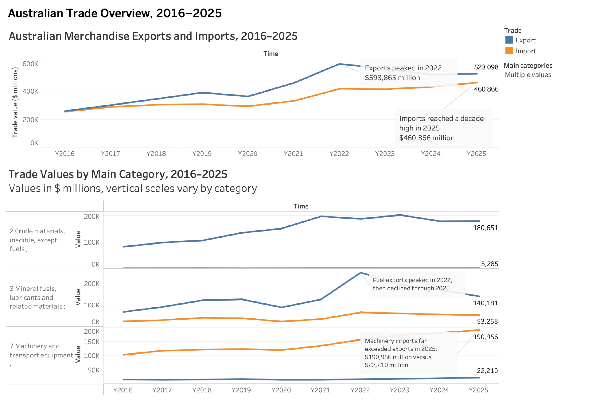
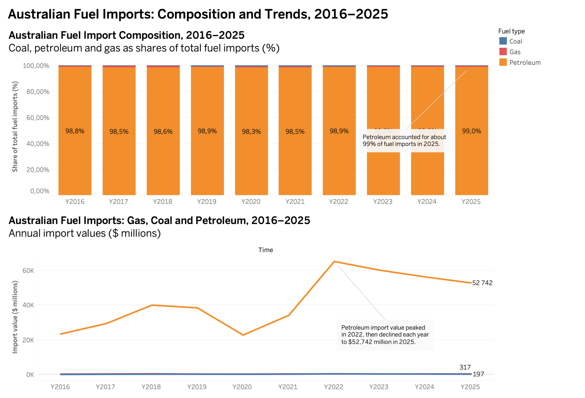

# Australian Trade & Gas Export Outlook | 澳大利亚贸易与天然气出口展望

**课程：** UTS 32146 Data Visualization and Visual Analytics · 个人课程项目  
**工具：** Excel · Tableau · 数据清洗 · 贸易结构可视化

## 背景与问题
研究课程数据中2016–2025年澳大利亚商品进出口趋势、贸易结构与燃料类别，并讨论2026–2030年天然气出口的规划不确定性。

## 数据范围
- 课程提供的2016–2025年度商品贸易数据，标注为经调整的澳大利亚统计局数据。
- 分析涵盖十个SITC主要类别及燃料相关子类别；不是服务贸易或全部国际收支。
- 报告中的金额为名义澳元，单位 A$ million。

## 我的方法
1. 在Excel保留原始进出口数据，并建立各类别年度份额、同比比率和合并分析表。
2. 处理主类别份额与子类别“占父类别比例”的不同分母，避免误读。
3. 使用Tableau折线图、小多图、堆叠柱状图及Story比较商品贸易、燃料结构与趋势。
4. 对天然气出口作2026–2030规划期预测，并明确预测不确定性与业务局限。

## 已核对的主要发现
| 指标 | 2016 | 2025 |
|---|---:|---:|
| 商品出口（A$ million） | 258,469 | 523,098 |
| 商品进口（A$ million） | 254,345 | 460,866 |
| 商品贸易顺差（A$ million） | 4,124 | 62,232 |

- 2022年商品贸易顺差曾达 A$176,863 million，随后收窄。
- 2025年粗原料与燃料合计占商品出口61.33%；机械及运输设备占进口41.43%。
- 天然气出口从2016年 A$18,480 million 升至2025年 A$61,513 million，但较2022年峰值下降32.88%。
- 2025年天然气占燃料出口的43.88%；石油约占燃料进口的99%。

## 预测解释
历史版本报告包含后来决定不再作为作品集成果展示的 AI-assisted naïve benchmark / retrospective check。本案例**不将该部分视为本人实际完成的额外实验**。最终预测数值和可视化应在核对最终版Tableau工作簿后补充。现阶段重点展示已经完成的Excel计算、Tableau分析和可直接核对的历史数据。

## 我的贡献
独立完成Excel预处理、份额与年度比率计算、Tableau图表和Story、贸易趋势分析及书面报告。

## 局限
- 名义金额未进行通胀调整；贸易价值变化不等于实物出口量变化。
- 预测区间存在不确定性，不应当作确定的未来收入。
- 课程数据经过调整，不能直接与定义不同的外部统计系列混合比较。

## 可展示证据与下一步
- 已核对：历史贸易指标和分析方法（课程报告）。
- 待添加：最终版 `.twbx`、Excel工作簿、Tableau实际截图和确认过的预测图。
- 不公开包含学号的原始报告；发布前先脱敏。

[返回作品集](https://xuefeizhao2022-star.github.io/clothing-fit-prediction/)

## Tableau 原始图表核查（2026-11-17）
用户已提供四张实际 Tableau 导出图：D1 Gas Export Analysis、D2 Trade Overview、D3 Fuel Import Analysis、S1 Australian Trade Story。D2和D3可作为首批展示候选；D1和S1仍出现 **AI-assisted naïve benchmark** 与方法对比文字，和本作品集明确排除该额外比较的要求冲突，**在修订前不作为正式公开图表**。

四张PNG目前仍是会话附件，**尚未提交到GitHub仓库**；此处不提供虚构的下载链接。发布后会补充实际文件链接。

## 精选的实际Tableau图表（待图片文件上传）

这两张是用户导出的真实Tableau仪表板。D1和S1保留在课程原作业中，但因含已决定不作为作品集成果的AI-assisted naïve benchmark比较，暂不公开。
