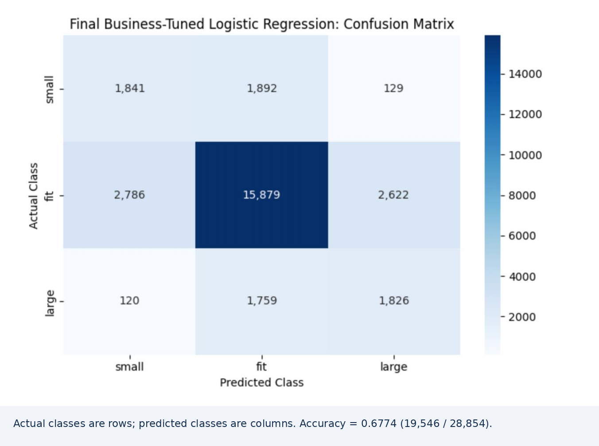
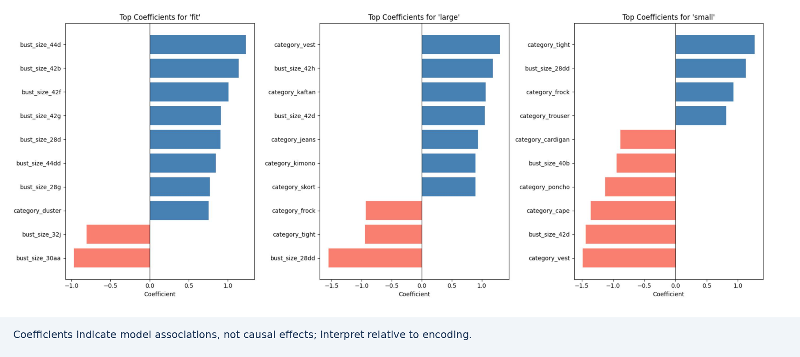

# Clothing Fit Risk Prediction | 服装尺码适配风险预测

> UTS Master of Business Analytics · Advanced Data Analytics Algorithms · Individual coursework project

## 业务问题
在线服装租赁场景中，用户在租赁前可能选到偏小或偏大的尺码。本项目使用公开 RentTheRunway 数据，预测 `small`、`fit`、`large` 三类尺码反馈，并讨论将 `small` 和 `large` 作为错码预警信号时的业务取舍。

**项目性质：** 个人课程机器学习项目和推理演示，不是已上线的商业推荐系统。

## 数据和特征
- 数据来源：UCSD McAuley Lab / RentTheRunway 数据集。
- 清洗后按类别分层划分为 70% 训练、15% 验证、15% 测试。
- Notebook保存的样本量：训练 134,648；验证 28,853；测试 28,854。
- 初始训练使用8项客户和租赁相关特征，包括尺码、年龄、体重、身高、胸围、体型、服装类别和租赁用途；后续引入产品标识，形成9特征版本。
- 评分和评论等租赁后信息未进入训练，以避免在租赁前预测时使用未来信息。
- 数值特征采用训练集统计量填补并标准化；类别特征处理缺失后独热编码。

## 建模流程
1. 检查重复、缺失和异常值，建立可重复的预处理流程。
2. 建立多数类基线、标准 Logistic Regression 和类别加权 Logistic Regression。
3. 增加产品标识，比较改进后的 Logistic Regression 与 Random Forest。
4. 在验证集比较不同类别权重，兼顾 Macro F1、错码召回率和误报率。
5. 固定最终权重 `fit:1, small:3, large:3`，合并训练与验证集重新拟合，仅在最终测试集评估一次。

## 最终测试集结果

| 指标 | 数值 |
|---|---:|
| Accuracy | 0.6770 |
| Balanced Accuracy | 0.5728 |
| Macro F1 | 0.5493 |
| Misfit Recall | 0.5196 |
| Misfit Precision | 0.4198 |
| False Alert Rate | 0.2553 |

以上取自 Notebook **Section 9 / cells 56–58 的保存输出**，测试集样本量为 28,854。Notebook Section 13 的文字总结出现略有差异的数值（0.6774 / 0.5718 / 0.5489），应在最终公开 Notebook 前统一。

### 为什么不直接选择最高准确率？
多数类基线在验证集的 Accuracy 为 0.7377，但其 Balanced Accuracy 只有 0.3333，且不能识别错码风险。最终模型的准确率较低，但更符合“识别不合适尺码”的业务目标。模型的误报率仍约25.53%，因此结果更适合作为研究性预警演示，而不是直接用于生产。

## 个人贡献
作为个人课程项目，完成数据质量检查、特征选择、预处理流水线、候选模型训练与比较、类别权重调整、测试评估和结果解释。

## 局限与下一步
- 加入产品标识后，现有测试主要反映训练期间已有产品的情况；新商品的泛化效果尚未验证。
- 数据来自历史租赁记录，不应直接推断对所有服装电商场景有效。
- 尚未完成生产部署、真实用户实验或线上A/B测试。
- 下一步：清理并公开不含个人学号的Notebook，补充数据使用说明、运行环境、混淆矩阵与业务风险说明。

## 作品集
[中文交互式作品集](https://xuefeizhao2022-star.github.io/clothing-fit-prediction/)

## 数据来源
Misra, R., Wan, M., & McAuley, J. (2018). *Decomposing fit semantics for product size recommendation in metric spaces*. RecSys 2018. https://doi.org/10.1145/3240323.3240398

---
**证据状态：** 本页根据上传的最终 `.ipynb` 的代码、Markdown与保存的运行输出整理；完整Notebook将在清理个人信息及核对不一致文字后公开。

## 原始报告图表与Notebook输出的版本说明（2026-11-17）
用户提供了最终报告中的 Figure 3（混淆矩阵）和 Figure 4（Logistic Regression 系数图）。Figure 3 的矩阵为：

| Actual \\ Predicted | small | fit | large |
|---|---:|---:|---:|
| small | 1,841 | 1,892 | 129 |
| fit | 2,786 | 15,879 | 2,622 |
| large | 120 | 1,759 | 1,826 |

该矩阵总样本数为28,854，对角线正确预测数为19,546，计算准确率为 **0.6774**，与原始报告的准确率一致，**并非本页前述Notebook保存输出的0.6770**。因此两套结果来自不同保存状态，尚不能混合引用为同一次测试；需重新核对或统一运行后再发布同组指标和图表。

原始图片及标注版已在会话中收到并生成，**目前尚未作为二进制图片提交GitHub**。待正式上传后补充真实文件链接。系数图是模型关联解释，不应做因果解释。

## 实际模型图（已上传）

**版本说明：** 图中的混淆矩阵对角线为1,841、15,879、1,826，样本总量28,854，计算得到 Accuracy 0.6774，**与原始课程PDF报告一致**；本页此前记录的0.6770来自另一份Notebook保存输出。两者不可视为同一轮测试输出。图片展示采用报告版本，Notebook版本指标保留来源标注，公开修订报告时再完成统一。
