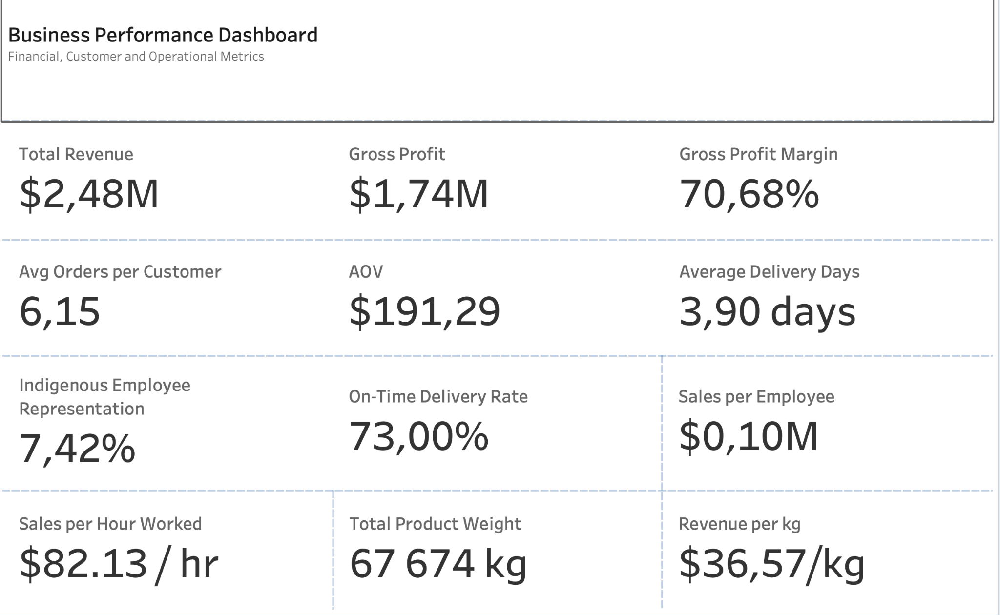

# Jubilee Superstores | 平衡计分卡与 KPI 仪表板

**课程：** UTS 22789 Financial Analytics · 个人课程报告  
**工具：** Tableau · KPI Design · Balanced Scorecard  
**性质：** 教学案例，不是对真实企业的商业咨询。

## 背景与问题
仅用销售额和利润衡量零售商表现不足以反映客户体验、物流效率与员工发展。该项目依据课程数据，为 Jubilee Superstores 设计覆盖财务、客户、内部流程、学习与成长四个视角的平衡计分卡，并用 Tableau 制作 KPI 仪表板。

## 方法
- 按数据字段可用性选择并计算12项KPI。
- 在 Tableau 中先构建单独的指标工作表，再组织为多视角仪表板。
- 对候选指标进行辨别力检查：因为数据中大多数客户都是重复购买者，舍弃信息量较低的 Repeat Customer Rate，改用 Average Orders per Customer。
- 讨论目标值、业务解释和数据限制；目标值是建议，不是已达成的结果。

## 报告中的指标（基于课程数据）
| 指标 | 报告数值 |
|---|---:|
| Total Revenue | 约 A$2.48m |
| Gross Profit | 约 A$1.74m |
| Gross Profit Margin | 70.68% |
| Average Order Value | A$191.29 |
| Average Orders per Customer | 6.15 |
| On-time Delivery Rate | 73% |
| Average Delivery Days | 3.90天 |
| Revenue per Kilogram | A$36.57/kg |
| Indigenous Employee Representation | 7.42% |

这些数字来自本人提交的《Balanced Scorecard Design Proposal and Dashboard Report》，不是企业实际经营数据的独立审计结论。

## 分析洞察
- 财务指标表现较强，但准时交付率为73%，报告提出将其提高至90%的**建议目标**。
- 选择“每客户平均订单数”而非几乎饱和的复购率，能更好地区分客户购买频率。
- 数据缺乏直接客户满意度、员工参与度和环境影响指标，因此不能把配送时效等代理指标当成直接满意度测量。

## 我的贡献
独立撰写平衡计分卡方案、筛选和调整KPI、在Tableau中制作指标工作表与仪表板、解释指标之间的联系和局限。

## 可展示证据与待办
- 已核对：课程最终报告的指标、方法及局限性。
- 待添加：原始Tableau Dashboard截图、计算字段、可分享的工作簿或经脱敏的报告。
- 尚未上传截图，因此不以示意图冒充真实Dashboard。

[返回作品集](https://xuefeizhao2022-star.github.io/clothing-fit-prediction/)

## 实际Dashboard证据（2026-11-17补充）
已收到用户提供的最终 Tableau **Business Performance Dashboard** 截图，标题副标题为“Financial, Customer and Operational Metrics”，画面完整展示12项KPI：Revenue、Gross Profit、Gross Profit Margin、Avg Orders per Customer、AOV、Average Delivery Days、Indigenous Employee Representation、On-Time Delivery Rate、Sales per Employee、Sales per Hour Worked、Total Product Weight、Revenue per kg。截图中收入$2.48M、毛利$1.74M、毛利率70.68%、AOV $191.29、订单数/客户6.15、平均配送3.90天、准时率73.00%，与课程报告的已整理数据一致。

**发布状态：** 真实截图已收到并裁剪为适合网站的文件，但PNG已提交到GitHub；仓库现有的`kpi-highlights.svg`仅是根据报告数值重绘的摘要，不是Tableau原图。正式图片上线后在此补充链接。

## 实际Tableau KPI Dashboard（已上传）

该图为用户提供的真实Tableau截图；12项KPI均保留。图片已上传，可直接在此查看。
