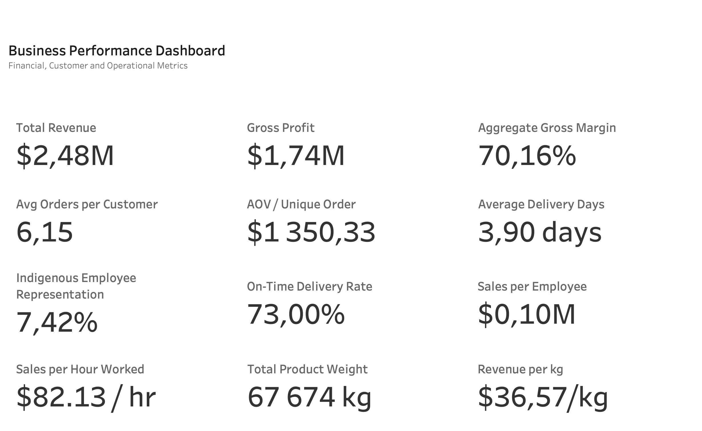

# Jubilee Superstores | 平衡计分卡与 KPI 仪表板

**课程：** UTS 22789 Financial Analytics · 个人课程报告  
**工具：** Tableau · KPI Design · Balanced Scorecard  
**性质：** 教学案例，不是对真实企业的商业咨询。

## 背景与问题
仅用销售额和利润衡量零售商表现不足以反映客户体验、物流效率与员工发展。该项目依据课程数据，为 Jubilee Superstores 设计覆盖财务、客户、内部流程、学习与成长四个视角的平衡计分卡，并用 Tableau 制作 KPI 仪表板。

## 方法
- 按数据字段可用性选择并计算12项KPI。
- 在 Tableau 中先构建单独的指标工作表，再组织为多视角仪表板。
- 对候选指标进行辨别力检查：因为数据中大多数客户都是重复购买者，舍弃信息量较低的 Repeat Customer Rate，改用 Average Orders per Customer。
- 讨论目标值、业务解释和数据限制；目标值是建议，不是已达成的结果。

## 公开修正版指标（基于课程数据）
| 指标 | 公开修正版 |
|---|---:|
| Total Revenue | 约 A$2.48m |
| Gross Profit | 约 A$1.74m |
| Aggregate Gross Profit Margin | 70.16% |
| AOV / Unique Order | A$1,350.33 |
| Average Orders per Customer | 6.15 |
| On-time Delivery Rate | 73% |
| Average Delivery Days | 3.90天 |
| Revenue per Kilogram | A$36.57/kg |
| Indigenous Employee Representation | 7.42% |

以上采用已公开**求职修正版**工作簿和截图口径：总毛利率=SUM(Gross_Profit)/SUM(Revenue)，每笔唯一订单平均收入=SUM(Revenue)/COUNTD(Order ID)。原课程报告分别显示70.68%和A$191.29，属历史定义，不与本版混用；数值均为教学数据，不是经审计的企业业绩。

## 分析洞察
- 财务指标表现较强，但准时交付率为73%，报告提出将其提高至90%的**建议目标**。
- 选择“每客户平均订单数”而非几乎饱和的复购率，能更好地区分客户购买频率。
- 数据缺乏直接客户满意度、员工参与度和环境影响指标，因此不能把配送时效等代理指标当成直接满意度测量。

## 我的贡献
独立撰写平衡计分卡方案、筛选和调整KPI、在Tableau中制作指标工作表与仪表板、解释指标之间的联系和局限。

## 可展示证据与后续完善
- 已核对：课程最终报告的指标、方法及局限性。
- **已上传：** [求职修正版 Tableau 打包工作簿（脱敏）](../../Jubilee_Tableau_Portfolio_Corrected_v3.twbx) 和 [对应的12项KPI Dashboard截图](../../Dashboard.png)。
- 原课程报告的指标口径和截图作为历史版本保留；公开求职版的两项指标已经修正。

[返回作品集](https://xuefeizhao2022-star.github.io/clothing-fit-prediction/)

## 实际Dashboard证据
本项目求职修正版 Tableau **Business Performance Dashboard** 截图，标题副标题为“Financial, Customer and Operational Metrics”，画面完整展示12项KPI：Revenue、Gross Profit、Gross Profit Margin、Avg Orders per Customer、AOV、Average Delivery Days、Indigenous Employee Representation、On-Time Delivery Rate、Sales per Employee、Sales per Hour Worked、Total Product Weight、Revenue per kg。截图中收入A$2.48M、毛利A$1.74M、**总毛利率70.16%**、**每唯一订单AOV A$1,350.33**、订单数/客户6.15、平均配送3.90天、准时率73.00%。修正后的两项计算口径与原课程截图不同。

**发布状态：** 修正版实际Tableau Dashboard PNG及脱敏TWBX均已上传GitHub；`kpi-highlights.svg`仅是重绘摘要，不是Tableau原图。

## 实际 Tableau KPI Dashboard

该图是基于原课程工作簿进行脱敏及两项公式调整后，在Tableau中实际显示的12项KPI截图；[原课程截图](../../jubilee_dashboard.png)保留供历史对照。

### 商业洞察与面试讲解
[查看12项KPI的商业含义、建议和局限](BUSINESS_INSIGHTS_CN.md)。

[查看打包CSV逐项复核、毛利率差异及AOV口径说明](DATA_VALIDATION_CN.md)。
